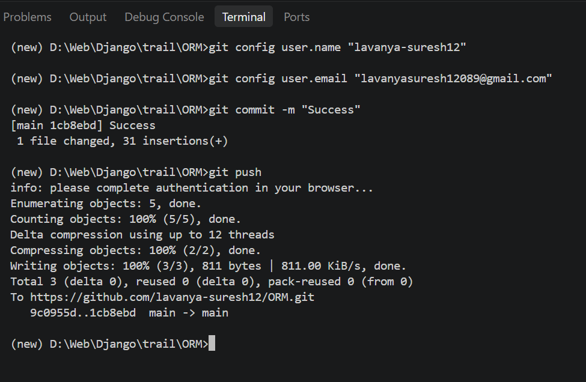
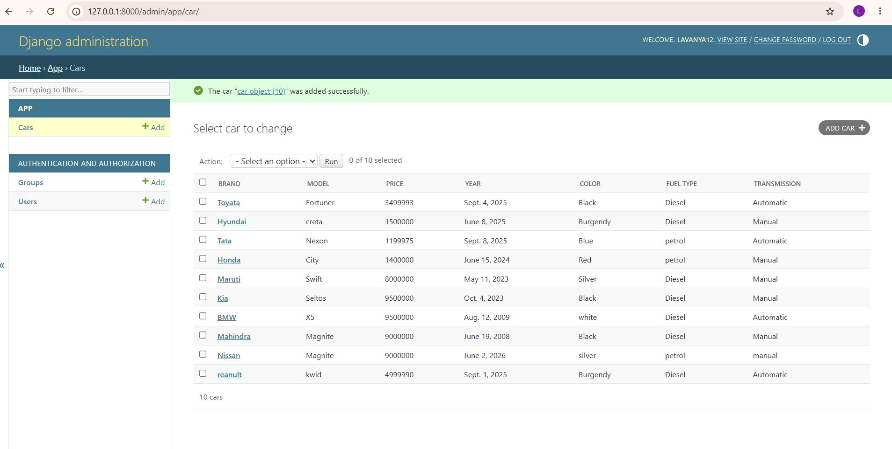

# Ex02 Django ORM Web Application
# Date: 21/11/2026
# AIM
To develop a Django application to store and retrieve data from a bank loan database using Object Relational Mapping(ORM).

# DESIGN STEPS
## STEP 1:
Clone the problem from GitHub

## STEP 2:
Create a new app in Django project

## STEP 3:
Enter the code for admin.py and models.py

## STEP 4:
Execute Django admin and create details for 10 cars

# PROGRAM

```
models.py

from django.db import models
from django.contrib import admin

class car(models.Model):
    Brand=models.CharField(max_length=50)
    Model=models.CharField(max_length=50)
    Price=models.IntegerField()
    Year=models.DateField()
    Color=models.CharField(max_length=25)
    Fuel_type=models.CharField(max_length=25)
    Transmission=models.CharField(max_length=30)


class caradmin(admin.ModelAdmin):
    list_display=['Brand','Model','Price','Year','Color','Fuel_type','Transmission']

```

```
admin.py 

from django.contrib import admin
from .models import car, caradmin

admin.site.register(car,caradmin)
```
# OUTPUT
Include the screenshot of your admin page.



# RESULT
Thus the program for creating a database using ORM hass been executed successfully
